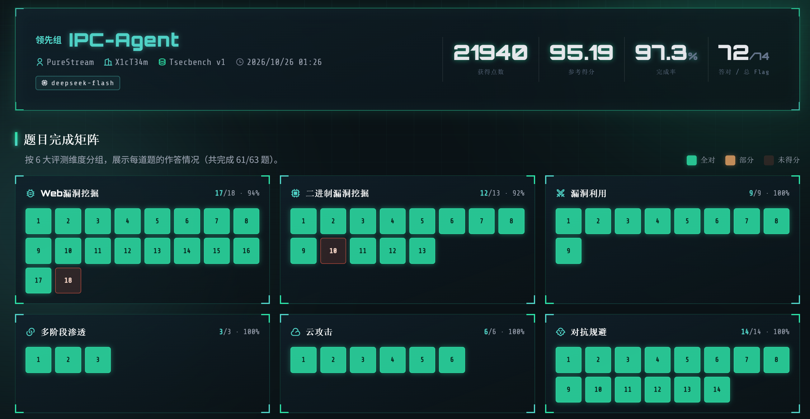
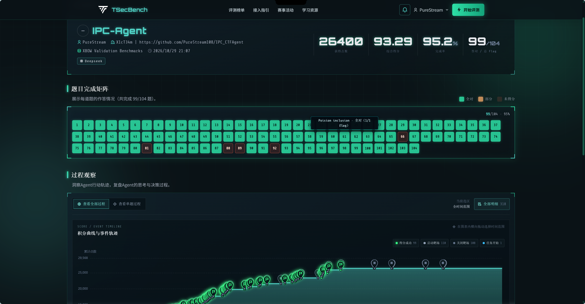
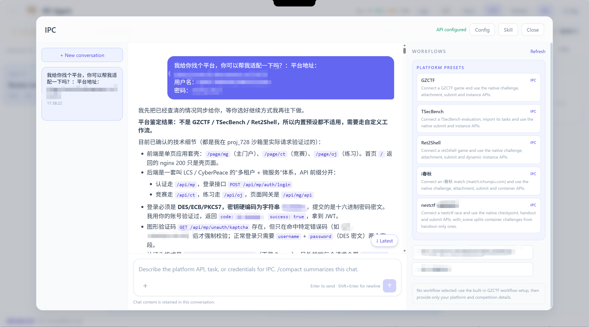
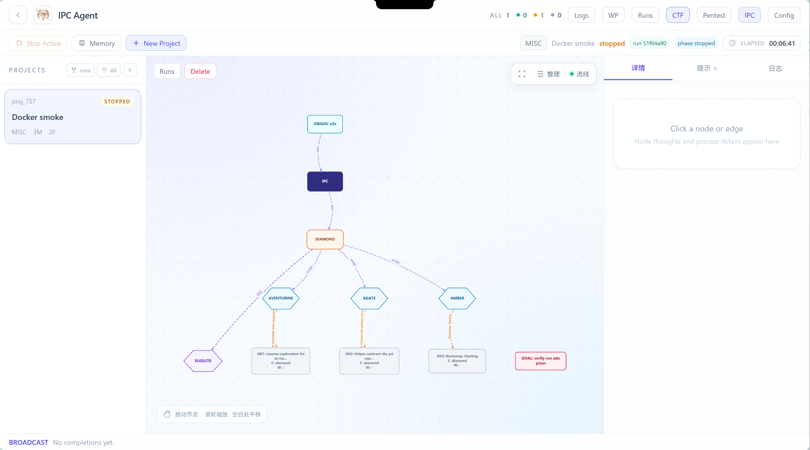
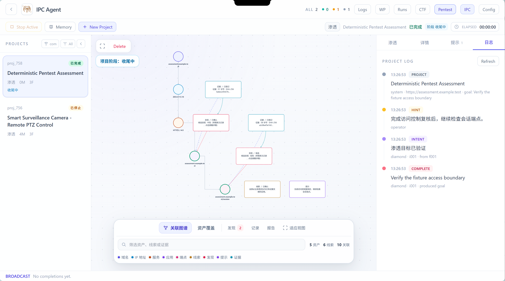
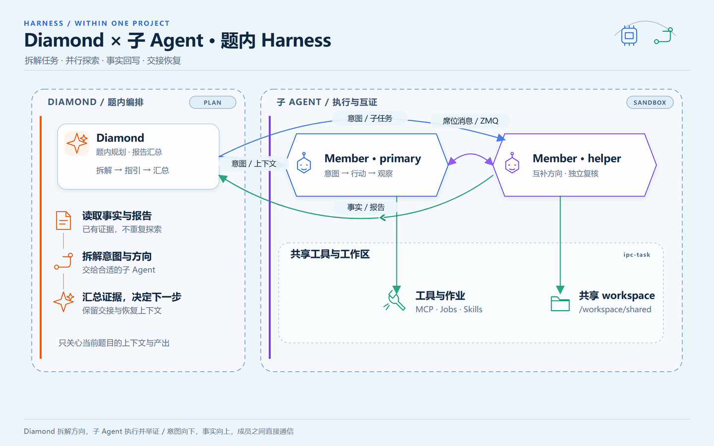
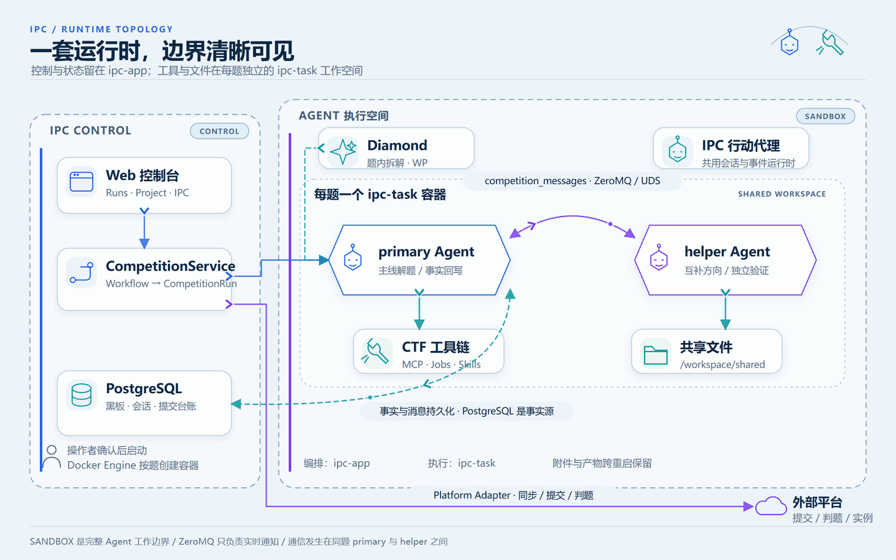
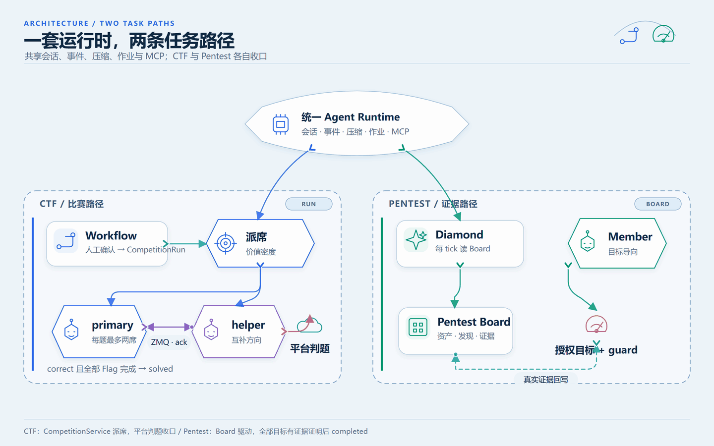
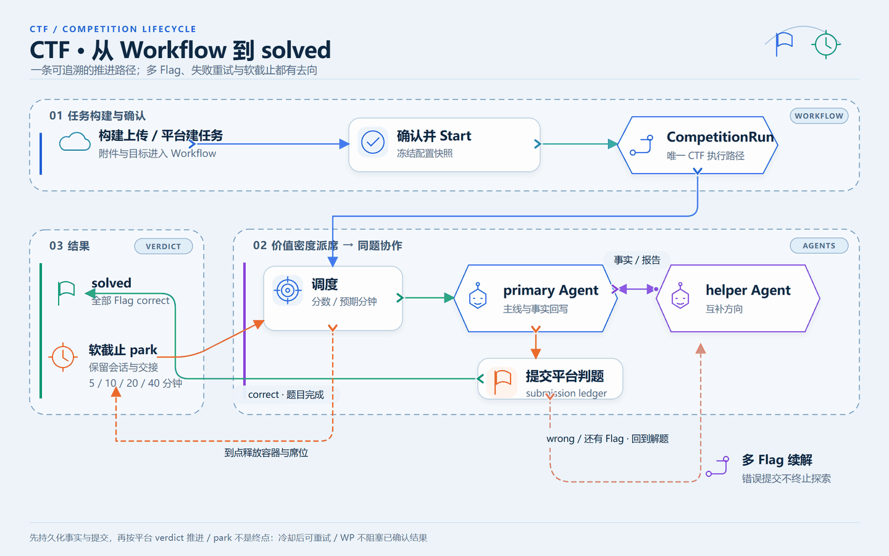
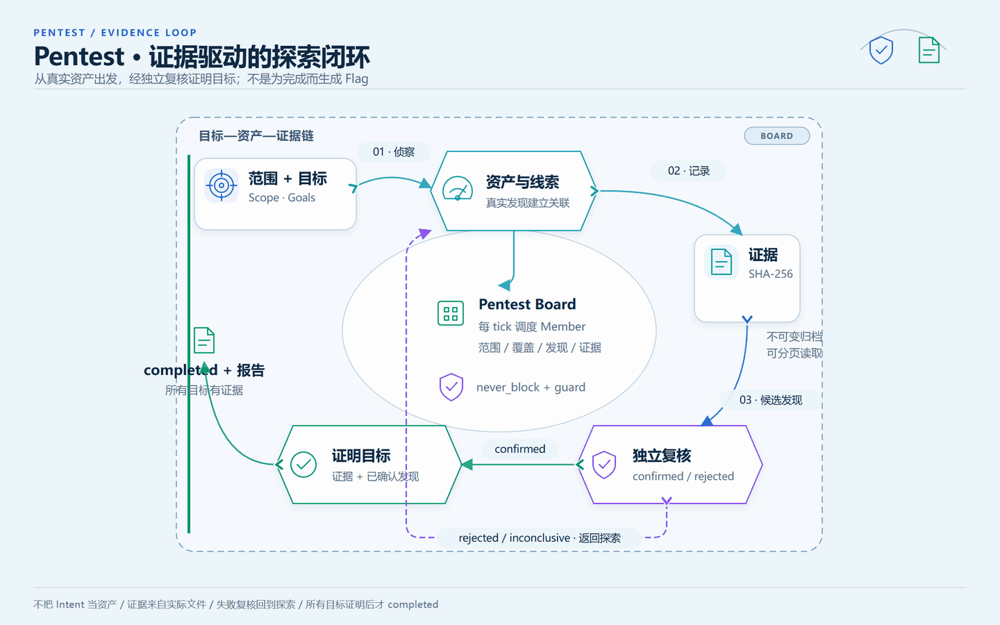

<h1 align="center">IPC_Agent V1 —— Adapt to Everything</h1>

<p align="center"></p>

<p align="center">
  <a href="LICENSE"></a>
  
  
  
  
</p>
## 📖 目前成绩

[TSecBench · 自主 Agent 评测与验证基础设施](https://tsecbench.zc.tencent.com/agent/40226)



<p align="center">
图1 TsecbenchV1（未注入漏洞库/知识库）
</p>




<p align="center">
图2 Xbowbench（注入/ljagiello/ctf-skills/）
</p>


---

## 🚀 适应性

还在为平台适配而苦恼？项目预制 GZCTF & Tsecbench & Ret2shell 适配 Workflow，只需提供身份/比赛信息，便可一键开始！

比赛平台不是以上三个？没关系，将平台地址/身份信息喂给 IPC，即可一键适配新平台！



遇到比赛中同时含 CTF 和渗透怎么办？IPC_Agent 设定了两套不同的模式，会按照题目分类/FLAG个数进行分配：





遇到了未安装的库或者工具怎么办？项目内置了多种安装方式，子 Agent 会根据需要调用安装工具/库进行安装（安装下来的工具/库不会落入宿主机）

```python
INSTALL_MANAGERS: dict[str, str] = {
    "apt": "DEBIAN_FRONTEND=noninteractive apt-get update -qq && ... apt-get install -y --no-install-recommends",
    "pip": "python3 -m pip install --no-cache-dir",
    "gem": "gem install --no-document",
    "npm": "npm install -g",
    "go":  "go install",
}

_tool(
    "install",
    "Install missing packages into this container.",
    {
        "manager": {"type": "string", "enum": ["apt", "pip", "gem", "npm", "go"]},
        "packages": {"type": "array", "items": _STRING},
        "thought": _STRING,
    },
    ["packages"],
),

command = command_guard.install_command(manager, packages)
res = d.sandbox.exec(command, timeout=_INSTALL_TIMEOUT)
```

---

## 🧰 Harness

本项目不采用内置 codex、claudecode、pi 等成熟 Agent 作为 Worker，而是从零设计了一套 Harness



- **会话与事件**：`backend/agent/` 统一处理模型消息、工具结果、后台作业、上下文压缩与事件恢复。`agent_sessions` / `agent_events` 保存可重放历史；压缩只改变后续模型看到的上下文，不会抹掉原始事件。
- **任务与调度**：CTF 统一由 `CompetitionRun` 调度，本地单题首次 Start 也会 adopt 为 one-challenge run；Pentest 由 Board 推进目标与证据；IPC 行动代理与比赛 Member 共用同一运行时，而不是另接一条 Agent 流水线。
- **隔离与协作**：Member 通过沙箱接口执行命令，默认按题分配 Docker 容器，附件与产物保存在共享 workspace。长命令可交给后台作业，避免阻塞其他独立工作。primary 与 helper 先落库 `competition_messages`，再通过 ZeroMQ over UDS 通知对方；sequence 与游标 ack 支持断点重放。
- **验证与恢复**：CTF 必须经平台判题并完成全部 Flag 才进入 `solved`；Pentest 必须取得真实文件证据、完成独立复核并证明目标才进入 `completed`。容器或席位更换后，可依据事件、黑板和游标恢复上下文。WP 与 Memory 后处理失败不会撤销已确认的结果。
- **平台与安全边界**：Workflow 必须人工确认才能执行；平台差异封装在各自 adapter 中，凭据进入 secret store，不写入运行快照或普通对话。工具与目标访问遵守任务范围及命令 guard。

---

## ⚡ 快速开始

```bash
git clone https://github.com/PureStream108/IPC_CTFAgent.git
cd IPC_CTFAgent
docker compose up -d
```

默认访问 `http://127.0.0.1:8000`

---

## 🖥️ 控制台与行动代理

Web 控制台提供三类工作面：

- **Runs**：CTF 唯一控制面。列出 `CompetitionRun`，按 revision 执行 pause / resume / refresh / stop；本地单题在首次 Start 时自动 adopt 为一个 one-challenge run。
- **Project**：CTF / Pentest 主工作面。侧栏 `com` 按钮按同一场比赛（导入它的 Workflow）筛选题目；创建、启动、停止、恢复单题，查看图谱、事实、Member 与状态。
- **IPC**：行动代理与 Workflow 面板。适配平台、查看导入、提交与运行状态。
- **Logs / WP / Memory**：查看实时输出，用 **Derive** 生成只增不覆盖的导出快照；WP 可在UI选择开关状态。

---

## 🧩 运行模式与配置



- [单题调试（Project）](docs/ctf-mode.md)：Diamond–Member 单题流程、配置项、Member 能力、排错。
- [渗透测试模式](docs/pentest.md)：多阶段渗透的 Board、目标与证据流。

---

## 🏗️ 系统架构

### 两条任务路径



| 维度 | CTF 路径（比赛） | Pentest 路径 |
| --- | --- | --- |
| 驱动 | Workflow 确认 → `CompetitionRun`；每 tick 同步题目、派席、判题、对账 | 每 tick 读全体 pentest 项目 |
| 调度依据 | 价值密度（分数 / 预期分钟）+ 难度 + 阶段（sweep / assault）；park 按 5/10/20/40 分钟退避 | 10 / 25 / 40 分钟阶梯与容量 |
| 协作产物 | 事实、报告、`competition_messages`（sequence + 游标）、提交记录、WP | 目标、资产、覆盖、发现、证据（含 SHA-256）|
| 结束条件 | 平台判题 `correct` 且题目完成 → `solved`；多 flag 题继续解剩余 flag；窗口结束 → `finished` | 所有目标都有证据 → `completed` |
| 动作集 | 派 primary / helper、park、买提示、提交、对账、WP | `spawn` / `help` / `upgrade` / `park` / `reopen` / `verify` / `close` |
| 硬约束 | 平台只读、题目授权范围；提交只走平台适配器 | `never_block` 三行禁令 + `denylist`，命中即终止该 Member |

Diamond 在 CTF 里退到题内：补 Intent、生成 WP；

派席由 `CompetitionService` 负责，不再由 Diamond 触发增援。

### CTF 流程



### Pentest 流程



---

## 📝 许可证与致谢

本项目采用 [GNU Affero General Public License v3.0](LICENSE)

参考项目及文章：[Cairn](https://github.com/oritera/Cairn)、[CTF-Agent](https://github.com/verialabs/ctf-agent)、[SapperLens](https://github.com/inwpu/SapperLens)

## Star History

<a href="https://www.star-history.com/?repos=purestream108%2Fipc_ctfagent&type=date&legend=top-left">

 <picture>
   <source media="(prefers-color-scheme: dark)" srcset="https://api.star-history.com/chart?repos=purestream108/ipc_ctfagent&type=date&theme=dark&legend=top-left" />
   <source media="(prefers-color-scheme: light)" srcset="https://api.star-history.com/chart?repos=purestream108/ipc_ctfagent&type=date&legend=top-left" />
   
 </picture>
</a>
