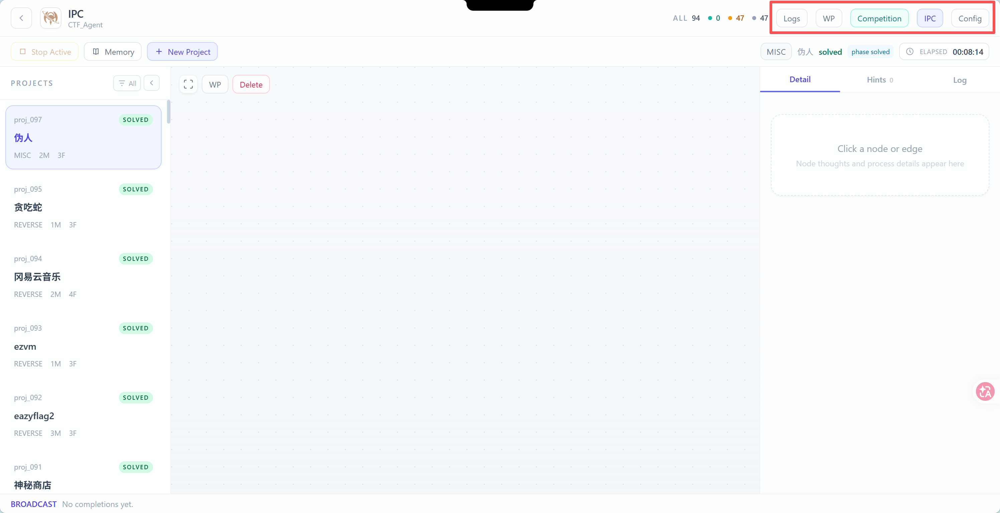

## 前端优化

在右上角按钮中增加一个Pentest按钮，进入之后能进入渗透任务界面，左侧Project显示的也只有被分为渗透类别的题目

## 功能增加

参考同目录下的Artex ，将他对于渗透的类型题目的机制集成进IPC_CTFAgent，但是不采用Artex中对于子Agent分配Claudecode/Codex的行为，子Agent依旧沿用本项目Agent Harness，然后画图也继承Artex的图表示形式，具体你可以调用一下

## Workflow

内置两个固定的workflow：GZCTF和Tsecbench，放置在IPC_CTFAgent\backend\platform对应目录下，每次对在这两个平台上的文件进行配置，只需要沿用固定workflow，填入个性化个人标识即可，tsecbench的API文档可以参考：D:\Desktop\Codex\IPC_CTFAgent\IPC_CTFAgent\backend\platform\tsecbench\CHALLENGES_API.md

## 测试

优化./github/workflow下的CI/CD测试，以更好适配tests/
