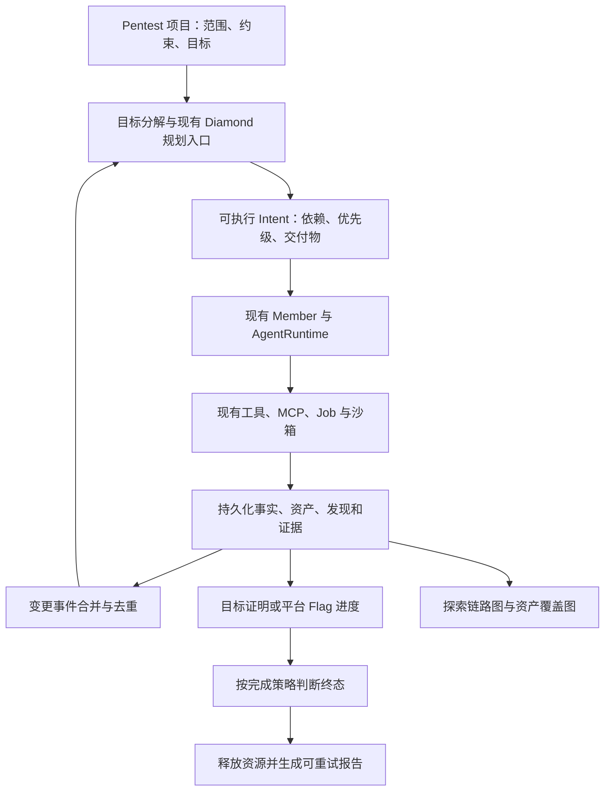

# IPC_CTFAgent：nextchange 完整实施计划

> 整理日期：2026-10-17；实施与验证完成：2026-10-18。需求来源：[nextchange.md](nextchange.md)。本轮任务已按验收标准实施并回填勾选，验证记录见第 8 节末尾。上一轮计划及其完成记录完整保留在文末“历史计划”中。

## 1. 本轮目标与交付范围

| 需求 | 最终交付 | 核心验收标准 |
|---|---|---|
| Pentest 入口 | 右上角新增 `Pentest` 按钮，进入渗透任务工作区 | 左侧仅显示 `pentest` 类别项目；切换工作区后列表、统计、当前项目和图谱一致 |
| ARTEX 渗透机制 | 目标分解、资产发现、事件驱动规划、依赖调度、发现验证、报告与恢复 | 完整跑通“目标 → 意图 → 执行 → 事实/资产/发现 → 再规划 → 证据验证 → 收尾” |
| 沿用 Agent Harness | 渗透子任务复用现有 Member、AgentRuntime、工具、沙箱和模型配置 | 不引入 Claude Code/Codex CLI 子进程，也不另建一套 Agent 执行引擎 |
| ARTEX 图表示形式 | 探索链路图、资产覆盖图和节点详情 | 能辨识起点、目标、意图、事实、发现、提示及关系；资产图支持已测高亮、折叠展开 |
| 固定平台 workflow | GZCTF、TSecBench 的模板分别归属对应平台目录 | 首次配置仅填写平台和个人身份参数；再次使用直接复用模板和已存配置 |
| CI/CD 测试适配 | 调整 `.github/workflows/ci.yml`，覆盖现有与新增测试 | 数据库、Node、浏览器、Docker 依赖显式准备；必要测试不因缺少依赖而静默跳过 |

本轮围绕这四组需求实施。历史计划的未完成任务保留原状态；只有直接影响本轮功能的控制可用性、MCP 可用性、资源回收等问题进入本轮前置检查，不将历史实赛复测自动纳入本轮执行范围。

## 2. 已核对的实现基线

| 范围 | 当前实现 | 本轮处理方式 |
|---|---|---|
| 前端 | `frontend/index.html` 为 Alpine 单页，图谱使用本地 Cytoscape/Dagre；项目列表当前主要按状态过滤 | 在现有单页中新增 Pentest 工作区和图谱视图，复用现有导航与详情面板 |
| 项目类别 | `backend/core/config.py::CATEGORIES` 与前端类别列表均没有 `pentest`；创建 API、IPC 工具均有类别校验 | 同步补充类别、API、工具、模型配置和导入流程，避免仅前端可创建 |
| 编排与执行 | 已有 Diamond/Orchestrator、Member、`backend/agent/`、持久化会话、job、租约及输出预算 | 通过渗透策略扩展现有编排和工具契约，继承执行与恢复能力 |
| 终态 | 当前项目主要围绕 verified flag、`flag_found`、`solved` 和后处理收尾 | 明确区分独立渗透目标完成、单题 Flag 验证和平台整题完成 |
| 平台模板 | `backend/ops/presets.py` 已有 GZCTF、TSecBench 输入模型、模板版本和 metadata，API 也已有模板入口 | 以迁移、规范归属和补齐行为为主，保留旧导入路径和现有接口兼容性 |
| TSecBench | 已有原生 adapter 和 `tests/test_tsecbench.py`；API 文档要求 VPN、最多 3 个实例、一题可有多个 flag | 按文档核对差异，重点补齐多 Flag 完成语义、网络预检、实例状态与扣分提示策略 |
| CI | 已有 `test`、`task-image`、`e2e` 三个 job；主测试有 PostgreSQL，前端部分测试依赖 Node，浏览器测试可因缺依赖跳过 | 保留已有门禁，按依赖分层并消除必要测试的环境缺口 |
| 覆盖率 | `scripts/check_coverage.py` 当前检查模块组行覆盖率；已有 80% 下限及 agent-core 81.33%、competition 80.93% 基线 | 保留既有下限和不回退规则；继续采集分支覆盖率，明确其与当前行覆盖率门禁的区别 |

ARTEX 参考仓库为 `D:/Desktop/Codex/ARTEX`。已对照以下实现与截图，后续按机制和界面表现移植到本项目：

- 目标、规划与执行：`agent/goals.go`、`agent/planner.go`、`agent/worker.go`、`server/engine.go`。
- 发现与证据：`agent/finding_workflow.go`、`agent/finding_recorder.go`、`agent/retester.go`、`report/`。
- 探索节点与关系：`db/constants.go`、`db/exploration.go`。
- 探索图：`web/src/components/exploration-graph.tsx`、`screenshots/graph.png`。
- 资产覆盖图：`web/src/app/(main)/function/tasks/detail/_tabs/coverage-graph-tab.tsx`、`screenshots/assets_test.png`。

ARTEX 的探索图采用 React Flow，资产覆盖图采用 G6 力导向布局；本项目沿用现有单页和图谱栈实现对应的卡片、关系与交互，具体渲染差异在图谱原型阶段验证。

## 3. 设计约定

### 3.1 项目分类与工作区

- 使用 `category="pentest"` 作为渗透类别的唯一规范值。`web` 等原有类别保留原语义；渗透任务的技术方向放入独立标签/元数据，避免将 `pentest` 和 `web` 混作同一分类层级。
- 前端新增 `workspaceMode`（`ctf` / `pentest`）。Pentest 入口展示完整工作区，默认工作区展示原有题目；`Competition` 继续作为平台运行管理入口。
- 后端项目列表支持可选 `category` 过滤，未传参数时保持原 API 返回全部项目的兼容行为。前端工作区列表、状态筛选、计数、默认选中项和批量操作统一使用同一作用域。
- 平台题目保留原始类别和显式类别映射。TSecBench 文档未提供标准 category 字段，不能将所有 TSecBench 题目自动判为渗透；支持个人配置中的显式类别覆盖，未知类别保守回退。
- 工作区切换只改变展示；暂停、停止和批量控制必须明确作用对象。切换后销毁旧图实例、解除旧订阅，使用独立选中状态或回到该工作区首个项目。

### 3.2 渗透策略与 Agent Harness



- 规划统一由现有 Diamond/Orchestrator 的渗透策略生成 Intent；资产、事实、发现、目标或用户提示变化触发再规划，采用事件合并、防抖和版本去重。
- 子 Agent 使用本项目现有模型适配器、会话、工具分派、上下文压缩、资源限制和取消机制。ARTEX 中面向 Claude Code/Codex 的分配方式不进入实现。
- PostgreSQL 继续作为运行状态事实源；大输出和证据正文进入现有 Artifact 存储，图节点和数据库记录保存引用、摘要及哈希。
- 所有任务、资产、发现、证据和事件必须可关联 `project_id`；平台任务额外保留 run、challenge、实例代际。既有 session/epoch/lease 校验延伸到新增写入路径。

### 3.3 完成语义

| 场景 | 完成依据 | 结果与收尾 |
|---|---|---|
| 普通 CTF 单题 | 沿用现有 Flag 验证契约 | verified flag 与 `solved` 原子提交，后处理可重试 |
| 独立 Pentest 项目 | 必需目标都有可追溯证据并通过验证 | 新增 `completed` 终态，不伪造 Flag；报告失败不撤销已完成状态 |
| 平台 Pentest/CTF 题目 | 平台定义的整题完成条件 | 目标进展指导探索；平台要求的全部 Flag 达成后才能整题 solved |
| 预算用尽、时间到或人工停止 | 截止/控制策略 | 保留部分结果与未完成原因，不冒充目标达成 |

独立渗透项目可以有多个业务目标，但沿用每个 Project 唯一终局 `goal` Intent 的不变量；子目标使用独立数据结构，不创建多个终局 Intent。完成策略在创建或导入时确定并持久化，不能仅凭当前工作区推断。

## 4. 实施任务

### NC0：契约和原型基线（P0）

- [x] **NC0.1 梳理可复用能力**：列出“直接复用 / 扩展 / 新增”的对应表；检查项目类别、图谱查询、调度、工具权限、完成/后处理和平台导入的调用链。
- [x] **NC0.2 固定最小样例**：构造本地 fixture，包含独立渗透目标、串行依赖、失败路线、确认发现、资产新增，以及 TSecBench 两 Flag 题目；不依赖真实平台或模型服务。
- [x] **NC0.3 固定数据与事件契约**：确定目标、资产、发现、证据、覆盖和提交进度的字段、状态与主键；确定 API 响应、事件版本、分页和去重规则。
- [x] **NC0.4 产出 Pentest 图谱原型**：用 fixture 展示探索图、资产覆盖图、节点详情和空态，对照 ARTEX 截图核对卡片、布局、图例、关系和交互。
- [x] **NC0.5 前置能力探测**：在独立测试环境验证现有控制受理/停止、MCP 最小调用、沙箱与实例清理；直接阻断本轮链路的问题先定位并补最小修复。

验收：最小样例、接口契约、状态转换表和图谱原型一致；实施不依赖尚未确定的字段或终态语义。

### NC1：Pentest 分类、数据模型与持久化（P0）

- [x] **NC1.1 打通类别链路**：扩展 `CATEGORIES`、项目创建请求、前端创建表单、IPC/MCP 创建工具、平台类别映射，以及按类别选择模型/提示词/工具的 fallback。
- [x] **NC1.2 新增渗透领域数据**：在建议的 `backend/pentest/` 中集中 schema、store 和 service；通过 Alembic 增量迁移接入现有 PostgreSQL。
- [x] **NC1.3 扩展项目查询与详情**：提供类别过滤、目标/发现/资产摘要及完成策略；所有列表和关联读取按项目隔离，原响应字段保持兼容。
- [x] **NC1.4 接入完成与后处理状态**：补充 `completed`、业务目标进度和平台 Flag 进度；更新生命周期、状态统计、恢复、日志、导出和前端状态分组中所有终态判断。
- [x] **NC1.5 兼容已有数据**：历史项目保持原类别和完成策略，新增字段提供明确默认值；多目标仅新增业务目标记录，不破坏唯一终局 Intent 约束。

建议持久化实体如下，最终表名按项目风格确定：

| 实体 | 必需内容 | 一致性要求 |
|---|---|---|
| 目标 | 项目、描述、必需性、状态、证明引用 | 文本结论不能直接视为完成，证明与状态更新保持事务一致 |
| 资产及关系 | 类型、规范化标识、来源、范围归属、父子关系 | 同项目去重，保留原始值；不同项目不隐式共享结果 |
| 发现 | 独立 finding ID、标题、类型、严重性、资产、状态 | finding ID 与图节点 ID 分开，重复上报幂等归并 |
| 证据 | Artifact 引用、摘要、哈希、生产者、Intent/session、实例代际 | 只引用存在且当前项目可访问的证据，保留复现顺序 |
| 测试覆盖 | 资产、测试类型、状态、对应 Intent/证据、时间 | 区分未测、进行中、已测和不适用，失败探测不能变成已覆盖 |
| 平台进度 | challenge、总 Flag 数、正确数、已确认索引、整题完成状态 | 重复提交/恢复不重复计数，单 Flag 正确与整题完成分离 |

验收：新库初始化、已有库升级、历史项目读写、新渗透项目创建和重启恢复均通过；跨项目关联、重复记录和过期执行者写入受到约束。

### NC2：移植 ARTEX 渗透闭环，复用现有 Harness（P0）

- [x] **NC2.1 范围与目标初始化**：将项目 origin/goal 转为明确范围、操作约束和可验证子目标；保留用户明确填写的限制，不推断额外目标范围。模型分解失败时保留原始目标作为 fallback。
- [x] **NC2.2 事件驱动规划**：实现渗透 planning policy，读取已有事实、资产、发现、未完成目标和待办；按变更版本合并触发，只派发前置条件已满足的工作。
- [x] **NC2.3 依赖与调度**：Intent 携带目标、资产、依赖、优先级、负责人、输入证据、交付物与完成条件；串行利用链逐步解锁，独立路线沿用受限并发，重复方向按稳定 key 去重。
- [x] **NC2.4 执行与工具契约**：在现有 Member 工具注册中接入资产登记/查询、事实回报、发现上报、证据引用和目标证明；语义相同的能力复用现有工具，平台 Flag 继续使用 `submit_flag`。
- [x] **NC2.5 资产与覆盖回流**：工具结果和 Member 报告转成结构化增量；资产发现与实际测试分开记录，写入后唤醒规划并更新图谱。
- [x] **NC2.6 发现验证与复测**：候选发现先记录为待验证；验证 Intent 读取原始证据并回报确认/否定/无法复测。确认发现记录复现步骤、影响和修复建议，保留复测历史及证据版本。
- [x] **NC2.7 长任务和失败路线**：沿用 job 完成通知、大输出预算和上下文压缩；失败、无进展、重复方向转为结构化事实供规划调整，不无限重跑相同输入。
- [x] **NC2.8 完成与报告**：按持久化完成策略校验必需目标或平台进度；终态落库、停止新派发、取消剩余工作和资源释放幂等执行；渗透报告使用发现与证据，不套用必须有 Flag 的 WP 前提。
- [x] **NC2.9 暂停、停止与恢复**：保存规划待办和消费游标；重启后从 DB 恢复并核对租约，避免重复派发、重复提交和旧实例证据误用；报告失败独立重试。

验收：固定模型轨迹能够完成一条带依赖的探索链、一条失败替代路线和一次漏洞复测；过程全部使用现有 Harness，暂停/恢复和重启不丢证据、不重复副作用。

### NC3：Pentest 工作区与项目操作（P1）

- [x] **NC3.1 顶栏入口**：在 `nextchange/1.png` 标注的右上角按钮区域新增 `Pentest`，提供选中态及返回普通题目工作区的明确入口。
- [x] **NC3.2 统一列表作用域**：Pentest 列表仅含 `category=pentest`；状态计数、搜索/筛选、默认选中、空态及创建后跳转都与工作区保持一致。
- [x] **NC3.3 渗透任务创建与详情**：支持标题、范围、目标、约束、附件和必要的运行参数；Pentest 工作区默认类别固定为 pentest，目标/发现/资产/运行状态在详情可访问。
- [x] **NC3.4 控制与生命周期**：接入启动、暂停/恢复、停止、删除和报告入口；`completed` 正确显示为完成，停止不显示成功；批量按钮明确当前工作区或全局作用范围。
- [x] **NC3.5 状态与订阅隔离**：切换项目/工作区后重置节点详情和图谱，取消旧监听；刷新页面恢复合法选中项，删除当前项目后回到有效项目或空态。
- [x] **NC3.6 原功能回归**：Logs、WP、Memory、Competition、IPC、Config 仍能打开；渗透任务的报告入口和日志搜索正确关联当前项目。

验收：同时存在普通和渗透项目时，两种工作区的列表、统计、详情、控制及刷新恢复均正确；新建、删除、切换和空列表没有旧项目残留。

### NC4：探索链路图与资产覆盖图（P1）

- [x] **NC4.1 定义图谱投影**：复用现有黑板查询与 `backend/api/graph.py`，增加渗透图投影；图谱数据来自持久化事实，统一稳定 ID、节点类型、状态、关系和详情引用。
- [x] **NC4.2 探索链路图**：参照 ARTEX，实现从左到右的卡片式节点；起点灰色、目标绿色、意图蓝色、事实橙色、发现红色、提示紫色，配套图例、状态、优先级和编号。
- [x] **NC4.3 关系映射**：映射 `spawns`（派生）、`derived_from`（依据/意图链）、`yields`（产出）、`proves`（证明）；在投影中明确方向，保留原始数据，不为布局修改事实关系。
- [x] **NC4.4 节点交互**：支持拖拽、缩放、适应画布、节点/边点击详情、路径高亮与筛选；详情可追溯 Intent、工具结果、发现及证据。总览缩略图与原型一起评估实现。
- [x] **NC4.5 资产覆盖图**：使用力导向布局表达域名、IP、服务、站点/应用和端点；已测高亮、未测弱化、范围外区分，支持同类节点折叠/展开和范围内覆盖计数。
- [x] **NC4.6 增量与大图处理**：按版本或游标更新，保留用户视角与节点位置；大图使用分页/子图、分组折叠和详情按需加载。冷节点摘要不删除原始证据，展开可回溯。
- [x] **NC4.7 渲染健壮性**：处理空图、长文本、特殊字符、重复边、循环、多分支和项目切换；异步布局完成前卸载时不能继续访问已销毁画布。

验收：两种图都能展示同一 fixture 的真实持久化结果，重启/重放后关系和覆盖一致；浏览器交互与截图对照通过，不能只验证页面存在某个字符串。

### NC5：将固定 workflow 归属平台目录（P0）

目标目录结构：

```text
backend/platform/
  gzctf/
    adapter.py           # 现有原生协议实现
    workflow.py          # 固定模板、输入模型、默认值和模板版本
  tsecbench/
    adapter.py           # 按 CHALLENGES_API.md 对齐
    workflow.py          # 固定模板、输入模型、默认值和模板版本
    CHALLENGES_API.md    # 现有接口依据
backend/ops/presets.py   # 统一注册/枚举与旧符号兼容导出
```

- [x] **NC5.1 模板归属迁移**：把平台专属输入模型和模板定义移到各自 `workflow.py`；`ops/presets.py` 保持统一枚举与兼容导出，不复制出两套可独立漂移的配置。
- [x] **NC5.2 API 与 IPC 统一入口**：沿用现有 `/api/ops/workflow-templates` 和创建流程；前端、API、IPC 工具都调用同一模板构造入口，GZCTF 保持默认选择，自定义平台入口兼容。
- [x] **NC5.3 固定步骤与个性参数分离**：固定列表/启动/提交/查询/清理步骤随模板分发；个人只填必要平台和身份信息，不要求生成接口映射、复制工作流代码或重复协议探测。
- [x] **NC5.4 保存与复用**：记录 template ID/version、脱敏个人参数和 secret 引用；支持加载、修改、再次运行。修改配置沿用现有确认失效语义，历史 run 保存启动快照，不被模板升级原地改变。
- [x] **NC5.5 分发与配置预检**：验证 wheel 和 Docker 均包含模板；若引入提示词/YAML 资源，同步更新 `pyproject.toml` package-data。预检报告缺失字段、身份错误、附件来源、工具/网络不可达及实际并发来源。
- [x] **NC5.6 文档与迁移兼容**：更新平台 README、配置示例及首次/再次使用说明；已有 workflow 可运行并可在下次编辑时归一化，避免重新录入个人凭据。

| 模板 | 最少必填 | 可选个性化配置 | 固定流程 |
|---|---|---|---|
| GZCTF | 平台地址、game ID、已有会话 token 或账号密码 | 名称、队伍、截止时间、并发、附件来源、题目类别覆盖 | 题目/附件 → 需要时启动实例 → 解题 → 提交/最终判分 → 清理 |
| TSecBench | BENCHMARK_BASE_URL、BENCHMARK_TOKEN | 名称、并发、显式类别覆盖、提示使用策略 | 题目列表 → start/就绪 → 经 VPN 执行 → 多 Flag submit → close |

TSecBench 的任务身份由 token 确定，UI 不要求不存在的 game ID 或额外账号。两种模板的凭据均沿用 secret store，不进入模板文件、公开响应、图谱或导出日志。

验收：两个平台分别通过一次首次配置和一次已存配置复用；迁移前接口和导入符号保持可用，安装包在仓库目录之外也能加载模板。

### NC6：平台协议与 TSecBench 多 Flag 闭环（P0）

- [x] **NC6.1 GZCTF 原能力回归**：保留 cookie/账号登录、比赛与队伍身份、附件来源、实例启动/续约/停止、限流、异步 verdict、幂等提交和 correct 收尾；迁移模板不能退回通用 HTTP 映射路径。
- [x] **NC6.2 TSecBench 文档逐接口核对**：认证头固定为 `BENCHMARK_TOKEN`；核对 list、start、hint、submit、close 的方法、query/body 参数和返回结构；保留 `unique_code` 及平台原始进度字段。
- [x] **NC6.3 多 Flag 进度与整题判定**：单次正确提交记录对应 `matched_flag_index`、正确数、总数和得分，只有平台整题完成才能进入 solved；部分正确继续运行，保留已有结果。
- [x] **NC6.4 duplicate 与恢复**：`duplicate` 表示该 Flag 已处理，不能单凭这一响应把整题标为 solved；刷新题目列表核对进度，区分本地验证记录与平台已完成状态，避免伪造未知 Flag。
- [x] **NC6.5 实例状态与资源**：支持 `pending/available/stop_pending/stopped`，只有 available 且入口有效才交给 Member；兼容多地址；并发不超过平台 3 实例限制，显式配置 0 的继承/禁用语义并与现有调度一致，不把 0 当作无限容量。
- [x] **NC6.6 VPN 与私网连通性**：部署侧接通 VPN，API 和任务沙箱都验证实际可达性；预检明确区分平台 API 可访问与靶机不可达。凭据只发送到平台 origin，不附带到靶机请求。
- [x] **NC6.7 错误与重试**：`task_not_found` 按身份错误处理；`invalid_state` 结合操作与进度区分任务结束和实例满额；`resource_unavailable` 有界退避；422 参数错误不盲重试；终止路径幂等 close。
- [x] **NC6.8 提示扣分策略**：默认不开启自动 hint；预检不调用会扣分的接口。用户配置允许后才在需要时读取并记录扣分策略、请求与结果，不把 GET 一概视为无副作用。
- [x] **NC6.9 题目导入衔接**：类别覆盖在导入时固定到项目，平台原始字段可追溯；渗透策略与平台提交路径共享进度数据，达到一个业务目标不能提前关闭尚未完成的多 Flag 题目。

验收：mock 平台覆盖“2 Flag 首次正确仍运行 → duplicate 不增加计数 → 第二个正确才完成 → 资源关闭”，并覆盖实例满额、靶机不可达、过期、提示策略及重启后进度恢复。

### NC7：tests 与 CI/CD 门禁（P1）

- [x] **NC7.1 测试依赖清点**：按真实依赖补齐 `postgres`、`browser`、`docker`、`e2e` 等 marker；新增使用 DB 的模块不能依赖旧文件名清单碰巧生效，fixture 与 marker 检查同步维护。
- [x] **NC7.2 Python 与 PostgreSQL**：继续用 Python 3.11 和 PostgreSQL 16；保留每例独立 schema、迁移和连接回收检查，CI 使用 `--require-postgres`，数据库不可用时失败而非跳过。
- [x] **NC7.3 原生 PostgreSQL fallback**：为临时 PostgreSQL 测试显式安装/定位 `pg_ctl`，保持去除已有 DSN 后独立启动的验证路径，不依赖 runner 偶然预装的版本。
- [x] **NC7.4 Node 与前端行为**：显式安装固定 Node LTS，确保 `tests/js/ops_chat_checks.mjs` 实际执行；新增 Pentest 切换和图谱交互检查，逐步减少只匹配 HTML 字符串的覆盖盲区。
- [x] **NC7.5 独立浏览器集成测试**：测试环境显式安装 Playwright 和浏览器依赖，执行 `tests/test_browser_integration.py` 等真实浏览器测试；不改变任务镜像当前“不预装浏览器”的策略。
- [x] **NC7.6 Docker 与 E2E**：保留任务镜像工具验收、浏览器策略检查和 AI CPU smoke；扩展 fake platform、固定模型轨迹和 Playwright E2E，增加 Pentest 及 TSecBench 多 Flag 用例。
- [x] **NC7.7 覆盖率与分片**：所有必需测试在明确 job 中执行；如按依赖拆分 pytest，生成可合并且路径一致的 coverage 数据，合并后再执行原覆盖率门禁，不能以减少测试范围获得通过。
- [x] **NC7.8 质量与安装包检查**：运行 Ruff、compileall、Alembic SQL 与实际迁移、两个 Compose 配置校验，以及 wheel 安装后的平台模板加载 smoke。
- [x] **NC7.9 执行效率与诊断**：缓存 pip、浏览器和 Docker 构建层；设置 job 超时与分支并发取消策略；失败时上传 JUnit、coverage、应用/Compose 日志、截图和 trace，`always()` 清理测试栈与卷。
- [x] **NC7.10 必要检查汇总**：若拆分 job，增加汇总 gate，依赖 job 的失败/取消/异常跳过均不能被汇总为成功；核对现有分支保护所需检查名称，YAML 修改与仓库设置状态分别记录。

建议 job 划分如下，允许在保留同等覆盖的前提下合并低成本步骤：

| Job | 主要检查 | 必要环境 |
|---|---|---|
| lint-config | Ruff、compileall、迁移 SQL、Compose 配置 | Python、Docker Compose |
| test | 确定性 pytest 主套件、Node 行为测试、覆盖率 | PostgreSQL、Node、Python dev/docker 依赖 |
| postgres-fallback | 无 DSN 时的临时 PostgreSQL 与隔离回归 | 原生 PostgreSQL、pytest-postgresql |
| browser | 浏览器 MCP、页面和证据行为 | Playwright、浏览器、按测试需要提供 DB |
| package-smoke | wheel 构建、隔离安装和模板加载 | Python build 与临时虚拟环境 |
| task-image | 现有任务镜像验收、策略检查与 AI smoke | Docker 与构建缓存 |
| e2e | CTF、Pentest、GZCTF/TSecBench fixture 全链路 | Docker Compose、fake platform、固定模型、Playwright |
| required-checks | 汇总必需 job 状态 | 显式 needs 与失败传播 |

验收：PR 上全部必要检查实际执行，报告能识别跳过原因；不用真实模型密钥、平台账号或 VPN 即可通过确定性回归，失败后能定位到功能和依赖层。

## 5. 回归矩阵与验证命令

| 测试层 | 重点场景 | 建议落点 |
|---|---|---|
| 数据/迁移 | pentest 类别、completed、旧数据默认值、唯一终局 Intent、跨项目隔离、过期租约 | `tests/test_persistence_schema.py`、`tests/test_lifecycle.py`、新增 pentest store 测试 |
| 规划/Harness | 事件合并、依赖解锁、重复方向、失败路线、已有 Harness、暂停/取消/恢复 | `tests/test_orchestration.py`、`tests/test_agent_runtime.py`、新增 pentest policy 测试 |
| 发现/证据 | 候选与确认分离、证据不存在/越项目、重复上报、复测否定、实例代际变化 | 新增 pentest finding/evidence 测试 |
| 工作区/图谱 | 类别与状态组合过滤、批量作用域、刷新/删除、空图/大图、布局卸载、详情联动 | `tests/test_frontend.py`、`tests/js/`、Playwright E2E |
| 模板 | 两平台首次配置/复用、旧符号兼容、模板版本、凭据脱敏、安装包加载 | `tests/test_ops_workflow_selection.py`、`tests/test_ops_agent.py`、新增模板 smoke |
| GZCTF | 两种认证、附件、续约、限流、最终 verdict、终态幂等和清理 | `tests/test_gzctf_adapter.py`、`tests/test_gzctf.py`、competition 回归 |
| TSecBench | header/query/body、多 Flag、duplicate、提示扣分、VPN诊断、状态轮询、3 实例限制 | `tests/test_tsecbench.py`、新增平台 fixture/competition 联调 |
| CI/恢复 | DB 不可用硬失败、Node/浏览器未缺失、schema/连接回收、覆盖率合并、资源清理 | `tests/conftest.py`、`tests/test_coverage_gate.py`、CI 与 E2E artifacts |

实施时按任务先运行针对性测试，最终在隔离测试库运行下列已有门禁；新增的 marker/job 命令随 NC7 落地后补入 CI，避免文档命令与实际分组不一致。

```bash
python -m pytest -q --require-postgres --cov=backend --cov-branch --cov-report=term-missing --cov-report=json --junitxml=data/exports/pytest-ci.xml
python scripts/check_coverage.py
python -m ruff check backend scripts tests
python -m compileall -q backend scripts tests
python -m alembic upgrade head --sql
docker compose config --quiet
docker compose -f docker-compose.e2e.yml config --quiet
node tests/js/ops_chat_checks.mjs .
```

镜像和 E2E 在对应 job 中运行现有命令：任务镜像内执行 `scripts/c5_task_acceptance.sh` 与 `scripts/ai_smoke.py`；E2E 栈执行 `docker compose -f docker-compose.e2e.yml run --rm e2e-runner`。浏览器集成测试在显式安装依赖的测试环境执行，不把缺少浏览器导致的 skip 当作通过。

## 6. 实施顺序与里程碑

| 阶段 | 顺序与依赖 | 可评审交付 |
|---|---|---|
| M0 | NC0 | 字段/事件/状态契约、ARTEX 对照、图谱原型、确定性样例 |
| M1 | NC1；NC5 可在 M0 后独立推进 | pentest 项目能创建/查询/持久化；两个模板归属平台目录且旧入口可用 |
| M2 | NC2 依赖 NC1；NC6 依赖模板契约并与 NC2 对齐完成策略 | Harness 驱动的渗透闭环、多 Flag 完成与幂等清理通过后端回归 |
| M3 | NC3/NC4 基于 M0 原型和 M1 API，最终接入 M2 | Pentest 工作区、两类图谱、发现/证据详情与控制操作完整可用 |
| M4 | NC7 的环境准备尽早开始，功能测试随各任务补齐，最后收敛门禁 | 全量回归、安装包/镜像/E2E、诊断产物和更新后的使用文档 |

建议按数据模型、平台模板、渗透编排、前端图谱、CI 分成可独立回归的提交。每次提交记录影响文件、行为变化和验证结果；所有阶段结束时更新本计划勾选状态，未经验证的项目保持未完成。

## 7. 兼容、迁移和回退

- 数据库采用增量、向前兼容迁移。先添加表/字段并提供默认值，再接入写入与界面；迁移脚本需同时覆盖新建库与已有 schema 升级。
- Pentest 策略和新图谱按项目类别启用；普通题仍走已验证路径。回退功能时保留已写入的目标、发现与证据，不通过删除数据回退。
- `ops/presets.py` 保留旧输入模型导出，API 和已有 workflow 的 template ID 不变；模板版本升级不修改运行中的配置快照。
- 新增 `completed` 和多 Flag 进度会影响旧版终态判断；混合版本运行前检查兼容性。回退应用前排空/暂停相关项目并确认旧版能读取新状态，不承诺直接降级 schema。
- 前端只消费服务端持久化状态，图谱与统计不自行推断平台完成；失效订阅、重复事件和旧实例写入都必须可识别。

## 8. 最终完成清单

- [x] 右上角 Pentest 入口、项目过滤、计数、创建、控制和刷新恢复均通过浏览器验收。
- [x] 独立渗透任务可在无 Flag 的情况下凭证据完成目标；平台题仍遵循平台整题完成条件。
- [x] 目标、资产、意图、事实、发现、复测、证据、报告形成闭环，全部执行复用本项目 Harness。
- [x] 探索链路图和资产覆盖图达到 ARTEX 对照原型的表示与交互要求，图中结果可追溯实际证据。
- [x] GZCTF 与 TSecBench 固定模板分别放在 `backend/platform/<平台>/`，用户只需个性化配置即可创建并复用。
- [x] TSecBench 的多 Flag、重复提交、扣分提示、VPN/私网可达性、并发和资源清理均有确定性回归。
- [x] 历史普通题目、Competition、IPC、日志、后处理及已存 workflow 未出现行为回退。
- [x] CI 必要环境显式准备，既有覆盖率下限和基线保持，wheel/镜像/E2E 均完成验证。
- [x] README、平台文档和示例与最终实现一致，验收报告列明通过、失败、跳过及尚不可测项目。

### 本轮验证记录（2026-10-18）

实施中发现并修复了四个阻断验收的问题：

1. 竞赛 recon 广播被同一 challenge 的所有订阅者接收，成员收到队友记录时抛 `recon record belongs to a different receiver session` 并触发重试；现在按 receiver session 过滤（`backend/competition/transport.py`）。
2. `platform_flags` 项目沿用“单 Flag”不变量，多 Flag 题目的第二次提交被 `assert_flag_compatible` 拒绝；现在允许逐 Flag 验证，项目 settled 后仍锁定最终 Flag（`backend/core/ipc.py`）。
3. 竞赛成员提交候选 Flag 时提前写入 goal 边，单 Flag 正确就会被当作整题完成；现在由平台整题完成后的 `_on_correct` 创建 goal 边（`backend/members/base_member.py`）。
4. 成员任务结束后未关闭 ReconSubscriber 的 ZeroMQ context/socket，循环垃圾回收在 `zmq_ctx_term` 阻塞整个解释器；现在在成员线程内释放（`backend/core/orchestrator.py`）。

| 检查 | 结果 |
|---|---|
| 全量 pytest（Linux/Python 3.12 + PostgreSQL 16，`--require-postgres`，`-n 8`） | **865 passed, 3 skipped, 0 failed** |
| 覆盖率门禁 `scripts/check_coverage.py` | agent-core **81.46%**（基线 81.33%）；competition **83.04%**（基线 80.93%） |
| 浏览器/MCP pytest（Playwright 1.50 + Chromium） | **24 passed** |
| TSecBench/平台针对性测试 | **32 passed, 1 skipped** |
| 浏览器 E2E（`docker-compose.e2e.yml`） | **连续 2 次通过**：run finished，2/2 Flag，观察到 partial progress，实例 close 1 次，无残留 assignment |
| Ruff / compileall / Alembic SQL / Compose config / Node 检查 | 全部通过 |

E2E 产物见 `data/exports/e2e/`（`result.json`、`tsecbench-result.json`、`pentest-exploration.png`、`pentest-assets.png`、`tsecbench-completed.png`）。本机未触发 GitHub Actions 远端 CI，也未重建 wheel/镜像；沿用 2026-10-17 已完成的包加载与任务镜像验收。

---

<details>
<summary>历史计划：上一轮可靠性、协同与 GZCTF 改进记录（完整保留，勾选状态不代表本轮实施状态）</summary>

# IPC_CTFAgent 下一阶段改进方案

> 本轮实施范围：执行本方案；任务 G 仅复测两道平台未解题（一题非容器、一题容器）。新增任务 J，将 GZCTF 通用流程内置为默认 workflow 模板，用户后续只填写平台地址、比赛与身份等个性化信息；在 G 中同时验证该内置入口。

执行顺序：先核对 H1 的实现基线并修正 H2 的指标口径，按任务补齐 H3/H5 的必要观测；优先推进 A 的输出/压缩预算、续约、提交、控制可用性及终态幂等，随后完成 B/I/C 的工具与协同改进。H4 与 E 可独立推进，不阻塞已定位故障的修复；性能结论以相关观测就绪为前提。每项变更立即运行针对性回归，最后完成 F 全量门禁和 G 实赛对照。A4/B4 同属高优先级控制可用性工作。

## 任务 H：基线、观测校正与监控效率

- [x] **H1 实现与部署状态对齐**：记录源码 commit、镜像版本、脱敏配置快照、模型和资源限制；核对 A3、B3、B4、B5、D1 的当前实现与历史故障版本。分别记录监控观察窗口、历史事件覆盖窗口和快照时间，区分原始报告与后续协同导出的状态。
- [x] **H2 修正延迟配对与吞吐口径**：
  - 首次分配、恢复启动、后续 intent 分别按 assignment/session/epoch/intent 配对；修正 `scripts/monitor_real_competition.py::metrics` 把所有 `member_start` 减去题目首次分配时间的统计。旧 R5 的 3195.156s 中位数不能当作首次启动延迟。
  - 提交分别统计 queued→submitted、submitted→ack、submitted→final、correct→solver 席位释放、correct→WP 排期。最终判分必须按 submission_id 选择终态 verdict，修正取第一条 pending 的 `setdefault` 口径。
  - 工具按 session/call 配对并校验 epoch/turn 边界；区分 pending、取消、失败和完成。首个 SSE 事件、首个有效内容、完整响应分别计时；缺数据保留 count=0/null。
  - 吞吐量只使用同一时间窗口内的事件；排除重复 `_monitor` 副本。多 Agent 累计秒数与 run 墙钟时间分别报告，不直接将累计耗时当作可节省的比赛时间。
  - 验收：固定事件轨迹覆盖多次启动、pending→final、跨快照/重放、缺失结果和取消，校正后指标能逐项追溯源事件。
- [x] **H3 补齐阶段耗时与资源指标**：记录 provider 请求/首事件/有效内容/完成、压缩、工具执行/输出传输/持久化、控制锁等待、DB 池等待、线程池队列、event-loop lag 和 CPU/内存；使用一致的 run/challenge/session/epoch/turn/call 关联。每个阶段明确开始、结束、超时和取消事件，避免只测 provider.started 之后的耗时。
- [x] **H4 降低监控与日志读取开销**：
  - 当前每轮按每题四类日志串行抓取，65 题最多 260 个 HTTP 请求；`sleep(5)` 是采集后的间隔。增加增量游标/聚合读取，按活跃题和日志类别采样；`backend/core/logging_util.py::_tail` 改为有限尾部读取，避免每次解析整个文件。
  - 用增量事件/日志保存证据，降低完整快照频率；兼容的双份报告按需生成，避免每轮重写两份数百 MB JSON。脱敏持续作用于增量和快照。
  - 监控自报请求数、响应字节、实际采样周期及采集/计算/脱敏/导出耗时。验收：增量采集无遗漏/重复，轮询成本不随全部历史线性重读；用开关监控的对照实验量化干扰，不把当前开销直接认定为 HTTP 冻结根因。
- [x] **H5 修复消息消费导出**：对齐 `scripts/generate_collab_report.py` 与 `CompetitionService._note_cursor` 的字段；保留消息 sequence/request_id、发送/接收 session、epoch，以及消费事件的 cursor/previous。当前 18 条消费导出的 request_id 均为空，不能据此宣称通信延迟正常。验收：可按游标范围关联已消费消息，支持批量消费、重放和去重，缺少关联证据时明确标记不可测。

## 任务 A：高优先级可靠性与资源预算

- [x] **A0 工具输出与上下文体积预算（新增）**
  - 证据：R5 单次工具结果约 38 MB，压缩后 payload 仍可超过 38 MB；`BaseMember._dispatch` 的 bash 完整 stdout/stderr 进入 observation，日志展示截取 4000 字符不能限制 runtime/provider 输入。
  - 在 sandbox 输出接收、tool_result 持久化和 provider 投影分别设可配置的单结果字节预算与整轮 token/字节预算，明确默认值和上限。大输出流式写入题目产物，返回摘要、有限头尾片段、总长度、哈希、路径和分页读取入口。
  - 尾部保留按总预算裁剪；压缩后重新检查体积，超大单条消息不能因“保留最近八条”继续无界驻留。完整证据通过产物可读回，并遵循现有脱敏与访问范围。
  - 验收：40 MB 输出用例中产物可完整读回，内联结果和压缩后上下文均满足预算；同一超大结果不反复触发无收益压缩；记录内存、事件体积、序列化时间和模型输入体积变化。

- [x] **A1（P2）实例续约→重建风暴**
  - 修 `backend/platform/gzctf/adapter.py::_gz_instance_view`：正确归一化 `closeTime` 的毫秒时间戳与时区；续约调度遵循平台允许续约窗口、剩余寿命和重试提示，不固定使用生命周期一半。
  - 修 `CompetitionService._renew_instances` 的错误分类：区分“尚不可延长”、限流、网络失败、认证失败和实例过期/不存在；暂时不可续约时稍后重试，只有确认实例不可用才进入重建流程。
  - renew/rebuild 事件补记脱敏后的平台错误码、原始报错、重试时间、实例 ID/代际和触发原因。
  - 验收：覆盖时间戳归一化、提前续约被拒、429、网络失败与确实过期；R4/R5 场景验证实例 ID/代际/端口连续性及超过 6 分钟的长连接完成，不能只以 recon 次数下降判定成功。
- [x] **A2（P3）flag 发现但未提交**
  - task_contract（`backend/members/base_member.py:2367`）明确「verified flag 必须以 `submit_flag` 工具调用收尾，写入 conclude/report 文本不算提交」。
  - 使用结构化 candidate/evidence/instance_generation 传递已验证结果；编排器在 intent conclude 时按比赛格式扫描文本作为兜底，命中且未提交时生成定向提交 intent 或追问 Member。
  - 文本命中先进入候选处理，沿用去重、wrong 冷却和实例代际校验；排除示例、旧结果与队友引用，避免重复或无效提交循环。
  - run 事件增加 `flag.found_in_fact_without_submission` 告警。
  - 验收：覆盖“conclude 含已验证结果但未调用 submit_flag”、示例误命中、重复候选、wrong 冷却和旧代际；复测中不再出现已有 verified 结果却长期 solving。
- [x] **A3（P4）candidate 通道 correct 收尾（已有实现，待验证）**
  - 当前 `CompetitionService._on_correct` 已在事务内补完成边、记录 verified flag、入队后处理并 finalize，随后释放 solver 席位。先核对部署版本并验证该路径，失败时针对性补修。
  - 验收：Member 与操作者 candidate 两个入口均正确收尾；重复 correct、事务失败重试和恢复不重复派发，primary/helper 席位释放，WP 正常排期，verified flag 与完成边一致。
- [ ] **A4（P1）HTTP 控制面整体卡死 ~25 分钟**
  - 结合 H3 的事件循环、线程栈/队列、DB 池、锁等待及进程资源数据定位；最后一批 `CallToolRequest` 仅作为时间线线索，MCP 根因仍待证实。
  - 根据阻塞证据决定线程/进程/控制端点隔离边界，与 B4 一起保证控制请求可持久化、可追踪，并在安全阶段边界生效；停止后的工作由租约/代际约束阻止继续写入。
  - 验收：在慢 MCP、慢平台请求、DB 等待和引擎高负载的可控场景下，轻量端点和控制请求仍满足预先设定的响应预算；控制已受理与已完成分别可观测，看门狗不再失效。
- [x] **A5 上下文压缩预算、异步隔离与降级可观测性（新增）**
  - 证据：R5 有 78 次压缩、43 次确定性降级标记；74 个含压缩的轮次间隔累计约 4.17 Agent 小时，30 个超过 300s。这是相关区间累计值，不等于压缩纯执行时间或可节省的墙钟时间。
  - 在 A0 输出预算基础上，为 `_compact → _semantic_compressor → adapter.chat` 增加独立开始/结束、attempt、总预算、降级原因、usage、前后 token/字节和保留事实/产物标识。压缩预算覆盖全部重试，不能仅依赖 ConversationAdapter 的 provider_read_timeout。
  - 阻塞摘要请求从成员事件循环移出，使用有界执行资源并支持关闭底层请求和取消；阶段性增量摘要保留事实、失败路径和产物引用。修正 summarize 内部吞异常后无法观察降级的情况。
  - 验收：超时、空摘要、巨型尾部、连续压缩、取消和资源饱和场景中，预算与并发有界、取消后无遗留请求；回放仍能恢复关键证据。真实模型耗时用于对照，截止机制用可控故障测试。
- [x] **A6 过期状态转换与清理幂等（新增）**
  - 证据：R4 同一道题产生 4238 条 `challenge.expired`，占 4480 条 run_events 的约 94.6%；`_stop_expired_challenges` 每个 tick 重复处理 expired 题。
  - 将首次 expired 状态转换与事件持久化绑定，重复 tick 不重复更新终态、停止项目或追加转换事件；未完成资源清理以独立状态和有界退避重试，支持崩溃后接管。
  - 验收：重复 tick 和重启恢复只产生一次状态转换；清理失败可恢复，最终席位、实例和引擎租约释放，不能通过简单跳过 expired 题掩盖残留资源。

## 任务 B：专项修复与已有实现验证（B4 按高优先级执行）

- [x] **B1（P5）provider 流式悬挂**：分别定义连接、有效内容静默与整轮总时长预算，心跳不代替有效进度；静默检测排除 supervisor "Continue" 等控制提醒，并纳入压缩阶段。超时/取消时关闭底层 response，验证无遗留线程/连接。覆盖持续心跳、首事件后无内容、慢流和取消场景。
- [ ] **B2（P6）MCP reverse/browser 不可用**：app 镜像补装 docker CLI，或 MCP 桥接改走 docker SDK；preflight 验证客户端、socket 权限、目标容器及真实 list_tools/最小工具调用。固定环境错误按 run 熔断并共享不可用状态，避免每个成员反复失败；修复后有明确探测恢复入口。验收：工具返回预期业务结果，错误率按可用服务分层统计，快速失败延迟不作为健康性能基线。
- [x] **B3（P7）WP 有界重试与生成质量（已有五次上限，待验证并补修）**：`CompetitionStore.claim_wp_job/finish_wp_job` 已有五次尝试上限、退避和 failed 终态。验证边界、取消、恢复和席位释放；针对 R5 17 个 job 共 61 次尝试、11 完成/6 失败，补齐证据输入、空输出与内容校验失败分类，记录 finish_reason、有效正文长度及 usage，按证据调整解析/预算。分别统计 job 尝试和内部 provider 调用，禁止不变输入无界重试。
- [x] **B4（P8）控制操作与 tick 锁竞争（高优先级，与 A4 联合验收）**：当前 `CompetitionService.control` 已等待 `_tick_lock` 最多 20s。定位长持锁阶段，缩小锁内平台 I/O，明确控制操作的持久化受理、排队/截止与完成反馈；验证 revision/租约冲突和重复操作幂等。验收不再以“增加一次等待”代替控制可用性。
- [x] **B5（P9）transcript 配对与恢复**：当前 `AgentRuntime._run_tool_group` 已按 provider 原顺序记录调用/结果。为并行工具部分失败、终结工具、压缩、取消和 session 重建补配对不变量校验；发现缺陷后最小化修复，保持原调用顺序与已发生副作用的语义，减少 `invalid_tool_order` 重建。
- [x] **B6（P10）ops sensitive 问题挂起**：生成问题时校验 secret 名白名单（`backend/ops/store.py:554`）；无法回答的问题提供 dismiss 通道。
- [ ] **B7（P11）附件 origin 白名单**：preflight 探测附件/CDN 域名和重定向并给出明确配置引导，通过 workflow 配置允许所需附件来源；验证下载成功和域名规则，使配置问题在 Start 前可发现。

## 任务 I：工具执行与长会话效率（新增）

> R5 工具调用 p50 约 0.193s，provider 完整响应 p50/p95 约 10.030/61.899s，provider 完成到首工具派发 p50 约 0.018s。优先治理大输出、长尾和低收益轮次；具体收益由对照实验验证。

- [x] **I1 长任务与完成通知**：对超过 bash 60s 预算的任务使用已有 job 工具，提供有界等待/完成通知和增量日志；连续超时触发执行方式调整。对包含 sleep 的调用区分等待与实际工作，不把整条调用耗时算成 sleep。验收覆盖长任务成功、取消、lost 和恢复，减少因错误执行方式导致的重复超时。
- [x] **I2 工具结果语义**：结构化记录 executor_status、process_exit_code、timed_out、输出截断状态及业务结果；修正监控仅凭 adapter status 判断命令成功的口径。非零退出按工具语义解释，缺失/未知结果单列。拆分执行、输出传输和持久化计时，解释 60s 工具出现约 90s 端到端长尾的来源。
- [ ] **I3 依赖与受限并发**：根据重复安装证据评估基础镜像/题型依赖缓存，比较镜像体积、启动和安装成本。复用现有 parallel_safe 查询并发；确有收益时增加受限只读接口或独立 job，并测试共享文件/目标冲突；任意 bash 和有副作用调用继续保持顺序约束。
- [ ] **I4 长会话阶段预算**：重点分析 R5 调用最多的四个 session（合计约占 provider.started 的 64.4%），在关键假设验证、持续无新事实、重复失败路径和 helper 交接时触发结构化复盘。记录轮次、prompt/output/reasoning usage 和新证据产出，采用软阶段预算与策略调整；不以统一轮次上限直接切断难题，避免重复计算 provider 中包含关系不同的 token 字段。

## 任务 C：多 Agent 协同与产物复用

> 后续协同导出共 96 条消息，全部为 competition-control 的 recon；Member 业务消息仍为零。已有 report/fact 广播代码，但观察窗口内 report/conclude 工具调用为零。R3/R4/R5 分别有 563/87/1113 次 bash 参数引用共享目录；目录被使用不能证明队友复用了产物。通信传输速度待 H5 补齐证据后再判断。

- [x] **C1 复用广播并补显式消息入口**：先验证 `Orchestrator.handle_report/_broadcast_fact → _publish_competition_recon` 的触发、同题授权、持久化、队友消费与重放；在 Member 工具中增加必要的 send/notify 能力，复用现有会话/epoch 校验和去重，不建立第二套消息总线。
- [x] **C2 共享产物交接**：约定 `/workspace/shared` 内按 owner/任务隔离的路径、版本/哈希、产物说明、运行方式及输入/实例代际；记录生产者、消费者和实际复用，避免同名临时文件冲突。验收包含队友运行同一版本脚本或引用同一证据的记录，而非仅统计目录访问。
- [x] **C3 helper 分工契约**：模板携带主线负责人、helper 子任务、依赖输入、交付物、完成条件和需要回报的阻塞。验证与替代路线明确区分；有目的的独立复核保留，重复完整分析需说明收益。helper 分配时优先读取已有事实/产物，避免从题目描述重新开始。
- [x] **C4 非终结事实与进度发布**：复用 report 或增加非终结事实/产物发布能力，在有意义的阶段将已验证事实、失败路径、脚本引用、证据和失效代际回流黑板并通知队友；避免为交流而提前 conclude 或每步广播。验证取消/重启后仍能检索和继续工作。
- [ ] **C5 通信消费与业务应用观测**：记录 publish→durable、durable→receiver_read、receiver_read→next_turn、next_turn→action/ack；按 run/challenge/message/sequence/session/epoch 关联。普通进展合并通知；目标变更等高优先级消息评估安全中断机制，验证长 provider/压缩期间的等待、去重、过期与恢复。
- 验收：固定双成员轨迹验证发送→持久化→消费→动作全链路、产物复用和明确分工；清理时处置未消费/过期消息。再以相同题目、资源和总模型预算比较单成员、当前 helper、分工 helper 的多次样本，报告成功率、墙钟时间、token/请求成本与重复分析证据。消息条数和消费延迟分布用于观测，不以“至少一条消息”或条数增长单独判定成功。

## 任务 D：低危与日志清理

- [x] **D1（L1）final verdict 投递与展示（已有事件，待验证）**：日志已有 R3 的 23 pending+23 correct、R4 的 6 pending+6 correct、R5 的 20 pending+17 correct+3 wrong。验证 query 最终事件到 SSE 重放和前端订阅的完整路径、同 submission 的状态更新与去重；仅在定位缺失环节后补修，避免重复发布。延迟指标同步使用 H2 的 final 口径。
- [ ] **D2（L2）** solved 后已排期 intent 的 `session cancelled` 降级为 info，消除 error 级噪声。
- [ ] **D3（L3）** 区分“把 Agent 工具误当 shell 命令”与“容器缺少 CLI”，为 `job_start` 等 IPC 工具名返回正确调用提示；保留真实命令失败记录，避免错误触发安装/补工具循环。
- [ ] **D4（L4）** 随 A1/A5/B1 修复验证 helper `lease_lost` 与 supervisor 提醒堆积；正常取消/代际切换与异常丢租约分开，重复 Continue 合并且不刷新业务进度，未消失的问题再单列。

## 任务 E：前端 Logs 弹窗搜索（nextchange）

- [x] 在 Logs 弹窗头部 **Enabled 复选框左侧**增加搜索输入框（`frontend/index.html:869-879`），对当前选中题目（`selectedLogProjectId`）当前日志类别（`globalLogKind`）的条目做客户端过滤，匹配 `globalLogDetail(entry)` 文本、event 名与 member。
- [x] 状态字段加在 `logEnabled` 附近（约 `frontend/index.html:1243`）；清空搜索时恢复完整列表；搜索词高亮可选。明确搜索范围是已加载条目，不将客户端过滤当成全量历史检索；与 H4 的增量加载保持一致。
- 验收：打开任一题目日志，输入关键字（如 `flag{`、`error`、member 名）列表即时过滤；切换题目/类别后行为正确；`Enabled`/`Derive`/`Close` 原有功能不受影响。

## 任务 F：逐项回归与最终全量门禁

每项实现完成即运行对应回归；全部变更完成后运行以下全量检查。A3/B3/B4/B5/D1 先验证已有路径，再根据失败结果决定补修。文档与历史状态更正不等于功能通过。

```bash
python -m pytest -q --require-postgres --cov=backend --cov-branch --cov-report=json
python scripts/check_coverage.py
python -m ruff check backend scripts tests
python -m compileall -q backend scripts tests
python -m alembic upgrade head --sql
docker compose config --quiet
docker compose -f docker-compose.e2e.yml config --quiet
bash scripts/c5_task_acceptance.sh
```

- [x] 两个模块组覆盖率 floor 保持 80%（基线：Agent 核心 81.33%、Competition 80.93%），赛后修改不得降低覆盖率要求。
- [x] PostgreSQL 测试每例独立 schema/migration，teardown 检查活动连接与 schema 残留，不使用共享库全局 TRUNCATE。
- [x] 针对性回归覆盖以下场景，使用 fixture、固定模型轨迹和可控故障验证不变量：

| 范围 | 必须验证的行为 |
|---|---|
| H | 启动/恢复分层，pending→final，游标批量消费/重放，统计去重，增量采集与脱敏 |
| A0/A5 | 40 MB 输出、压缩后体积预算、摘要超时/空结果、尾部过大、取消和资源有界 |
| A1/A2/A3 | 续约窗口及错误分类、长连接连续性、候选去重/代际、两个提交入口、重复 correct 与事务失败恢复 |
| A4/B1/B4 | 慢平台/MCP、DB/锁等待、流式心跳无进展、总预算、控制受理/生效与底层请求取消 |
| A6/B3 | 重复 tick/重启不重复转换，清理失败重试，WP 五次边界和内部调用计数，取消/恢复及席位释放 |
| B2/B5/C/I | MCP preflight/熔断恢复，工具历史配对、长任务状态、产物交接、消息应用和共享文件冲突 |
| D/E | final verdict 的 SSE/前端更新，日志类别/题目切换和搜索范围，预期取消日志 |

## 任务 G：新一轮实赛复测

- [x] **准备阶段核实并清理残留**：R5（`27a2e167b61b4e9fafdce67faa698926`）最后协同导出为 paused；先读取实际状态，仍非终态时完成 stop/清理，并确认实例、席位、后台 job、WP 和租约释放后再启动新 run。
- [x] **仅选两道未解题**：通过 J 的内置 GZCTF workflow 入口复用现有平台个性化配置，实时 preflight 后严格选择一道平台未解的非容器题和一道平台未解的容器题；保存 external_id、题目类别、remote 标记及选题时的 solved 状态。历史 workflow `wf_e99622b0bc7a49ca`（games/33）可作为配置来源；不扩大实赛题量。
- [ ] **明确自动结束与排空**：准备阶段配置并验证 workflow `ends_at` 或明确的 run 截止策略；到期停止接收新工作，提交/WP/资源清理在有界排空后进入终态。没有自动截止能力时先补齐并测试；仅以 `--max-duration` 结束观察的样本标记为阶段性观察，不算终态验收完成。
- [x] **使用 H 校正后的监控**：报告首次/恢复启动、provider 首事件/有效内容/完整响应、压缩、工具执行/传输/持久化、最终 verdict、控制锁等待、消息消费/应用、席位与实例生命周期、WP 生成/重试及监控自身开销的 count/p50/p95/max。额外记录事件/输出体积、token 成本、降级、超时和缺失数据。
- [ ] **记录两题行为与性能**：记录两题的成功率、墙钟时间、累计 Agent 时间、请求/token、实例连续性和产物复用；工具/MCP 按类型、服务与成功/失败分层。多次协同对照使用 F 的固定轨迹/fixture 完成，G 不额外启动比赛题目；两题样本不用于宣称一般性的性能提升。
- [x] **输出可复核证据**：使用更新后的 monitor 与 `scripts/generate_collab_report.py` 生成脱敏报告，带源码/镜像版本、观察/历史窗口、选题、资源来源和缺失项；汇总 A0/A5 预算、续约连续性、提交收尾、过期事件幂等、控制可用性、WP 和协同对照结果。
- 完成条件：run 到终态；solver/helper/WP 席位、实例、后台 job 和租约按策略收敛；消息 backlog 已消费或有明确终态处置；正确性、资源预算、取消/超时和控制用例通过。真实模型耗时按对照分布报告，未通过/不可测项明确列出，不因 solved 数或消息数增长标记整体完成。

> G 实测记录（2026-10-17）：内置 GZCTF workflow `wf_19361545b3868beb` 选中非容器 `1245` 与容器 `1244`。观察 2×600 秒后停止 run；容器题 `1244` correct/solved，实例 stop、无 rebuild；非容器题 `1245` 仍 solving，已明确记录为未通过项。

## 任务 J：GZCTF 默认内置 workflow（本轮追加）

- [x] **J1 内置平台模板**：以现有 GZCTF 原生适配器作为统一协议实现，内置题目发现、附件、实例生命周期、提交/异步 verdict 与能力预检；模板随项目分发，不含个人平台地址、比赛 ID、凭据或真实题目数据。
- [x] **J2 个性化配置入口**：提供默认 GZCTF workflow 的 API、IPC 工具与界面入口，只要求平台地址、比赛 ID、实际名称和认证；队伍、截止时间、并发及附件 CDN 等作为有说明的可选配置，沿用密钥存储和 workflow 确认机制。
- [x] **J3 复用与可诊断性**：相同平台配置可保存/复用，后续不再生成 HTTP 字段映射或探测通用 GZCTF 接口；配置错误在 preflight 给出具体字段和修正方式，保留其他平台/自定义 workflow 支持。
- [x] **J4 验证与文档**：覆盖 token 与账号登录、两种题型、CDN、续约窗口、异步判分、配置更新与确认失效、包内模板分发；README 说明首次配置与再次使用流程。G 的两题实赛使用此入口，报告记录模板版本与脱敏个性化参数。

## 注意事项（仍然有效）

- G 的自主实赛 Start 后仅使用只读 API、PostgreSQL 与 project/tool/LLM/memory 日志；记录 bug，不修改代码、不重启 Agent、不手工重试、不调整 limits、不主动 stop run。残留清理、配置调整与可控故障注入均在准备/独立测试阶段完成；实赛由启动前约定的自动截止策略结束。
- 启动前重新读取配置；普通题与容器题分别消耗 local/remote capacity，Member 席位用全局池；remote 上限依次取 run patch、workflow `remote_concurrency`、平台报告、旧 `remote_instance_limit`、平台默认 1，报告需记录实际来源，不能把 0 当无限容量。
- 修改 workflow 会使旧确认 token 失效，需按最新 spec 重新确认；`--max-duration` 只结束观察，不停止比赛，不能替代 G 的自动截止与排空策略。
- 计划、日志、报告和提交内容不包含密钥、Cookie、token 或真实 flag；验收产物保存在 `data/exports/`。
- 真实模型耗时用于分层对照，不作为固定性能失败条件；本地输出预算、配置的截止/取消机制和资源收敛用确定性测试作为硬验收。恢复信号与恢复后的实际进展分别记录，消息收到与产生业务作用分别记录。

</details>
